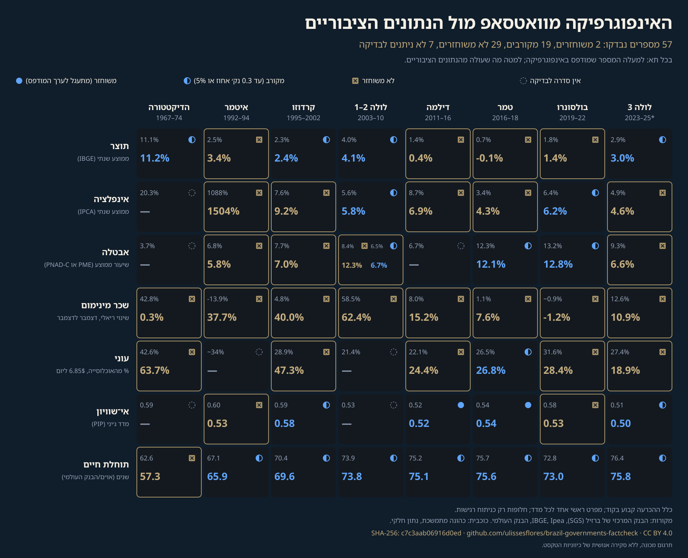

<div align="center">

# צילום רנטגן של ברזיל לפי ממשלה

**57 מספרים מאינפוגרפיקה ויראלית על שמונה ממשלות ברזיל, שנבדקו אחד-אחד מול נתונים ציבוריים תחת כלל שנקבע בקוד; ואז צילום הרנטגן של מה שהושמט: 101 סדרות משורשרות בגיבוב מאז 1964, מדד רשום-מראש של תנאי חיים והספרות שעברה ביקורת עמיתים על כל אפיזודה. ללא ציון ערך.**


[English](README.md) · [Português](README.pt-BR.md) · [Español](README.es.md) · [Italiano](README.it.md) · [עברית](README.he.md)

</div>

> [!IMPORTANT]
> **ממצא.** האינפוגרפיקה מדפיסה 57 מספרים. לפי כלל פסיקה אחד שנקבע בקוד, 2 משתחזרים במדויק מנתונים ציבוריים, 19 מתקרבים, 29 אינם משתחזרים, ול-7 אין סדרה רשמית שאפשר לבדוק מולה. היא גם משמיטה 34.3% מהחודשים שבין 1964 ל-2026 (257.6 מתוך 750.1): חמש ממשלות.
> מאגר זה אינו מדרג ממשלות ואינו אומר את מי ההשמטות מיטיבות. כוונה אינה ניתנת למדידה מתוך נתונים.

> [!NOTE]
> העברית היא תרגום אוטומטי, ללא בדיקה אנושית של הצגת הטקסט מימין לשמאל.

## מה תרומתו

1. **כלל פסיקה שנקבע בקוד** (`code/govfc/verdict.py`), המופעל על כל מספר באינפוגרפיקה, כשהמפרט הראשי מוצהר לכל מדד וכל חלופה שנוסתה מדווחת כרגישות.
2. **נתונים עם שרשרת גיבוב (hash chain) מרגע ההורדה.** כל קובץ נרשם בקובץ `manifest.jsonl` להוספה בלבד (append-only), שבו כל שורה נושאת את הגיבוב של קודמתה; לאחר מכן כל המאגר נחתם ב-`chain_hash` יחיד מסוג SHA-256.
3. **קטלוג של שברי שיטה ושברי כלל** (229 רשומות), עם הסיבה שכל מקור נותן, ההשפעה שנמדדה היכן ששתי שיטות חופפות, ואילו תאים באינפוגרפיקה חוצים כל שבר; בתוספת שכבה מאוצרת של 26,490 תצפיות ב-279 מדדים, עם מהדורת המקור (vintage) בכל שורה.

## במבט חטוף

| פריט | ערך |
|---|---|
| מספרים מודפסים באינפוגרפיקה | 57 |
| משתחזרים / מתקרבים / אינם משתחזרים / לא נבדקו | 2 / 19 / 29 / 7 |
| חודשים מתוך 1964-2026 שהאינפוגרפיקה משמיטה | 257.6 מתוך 750.1 (34.3%) |
| תצפיות מאוצרות / מדדים / שברי שיטה | 26,490 / 279 / 229 |
| פריטי המדד / אינדיקטורי הטרמינל / מחקרי Q1 בשכבת הספרות | 39 / 101 / 38 |
| תיקונים מתוארכים לרישום המוקדם | 0 |
| תלויות בזמן ריצה | אין (ספרייה סטנדרטית של Python, 3.11+) |

## התחלה מהירה

```bash
git clone <repository-url> && cd <repository>
python3 run_all.py
```

הפלט הצפוי מסתיים ב:

```text
run_all: OK [Track 1 (sealed series, no network)]
```

מסלול 1 אינו זקוק לרשת: הוא בונה מחדש את השכבה המאוצרת ואת התוצאות מהסדרות החתומות, מריץ את הבדיקות, ומאמת את החותם ואת כל שרשרת רכישה. מסלול 2 (`python3 run_all.py --full`) מוריד תחילה מחדש את הקבצים הגדולים של צדדים שלישיים שנשמרים רק כגיבוב ו-URL, ומריץ מחדש את סקריפטי הגזירה. ראו `REPRODUCIBILITY.md`.

## תוצאות

האינפוגרפיקה שנעשתה מחדש (כל מספר נקרא מ-`output/results.json` ונקבע בבדיקה):



כל תא מציג למעלה את המספר המודפס ולמטה את המספר ששוחזר, עם סימן פסיקה שאינו נשען לעולם על צבע בלבד.

## מעבר לאינפוגרפיקה: השכבות שנוספו

כל מה שלהלן נרשם מראש ונחתם בשרשרת הגיבוב לפני שחושב (0 תיקונים מתוארכים, שלעולם אינם נכתבים מחדש, ב-`data/raw/preregistro/`); הכללים נמצאים ב-`docs/he/METHODOLOGY.md`, סעיפים 11 עד 16.

1. **מדד משולב של תנאי חיים** (39 פריטים ב-13 תחומים, `output/indice.json`): כל פריט נכנס רק עם כיוון קריאה שנקבע במאמר מרבעון 1, מנוקד מול נקודות ייחוס קפואות 1995-2024, עם משקלות שווים מוצהרים, תרחישים מפורסמים ו-10,000 הגרלות משקלות. הוא מתאר תנאים במהלך כל כהונה; הוא אינו מדרג ערך.
2. **טרמינל של 101 אינדיקטורים ב-19 תחומים** (`output/terminal.json`, עמוד `output/raio-x.html`), בסיס הומוגני אחד לכל תא, שני בסיסים מצוירים כשני קווים ולעולם לא מאוחים, וקריאה לפי כהונה בשלוש שכבות נפרדות: המדד, ברזיל פחות אמריקה הלטינית על אותו מקור, והרשת "התחלה -> סוף".
3. **שכבת ספרות** (23 אפיזודות, 4 סבבים מפורסמים, 38 מחקרים, `output/literatura.json`): מה שמחקרים שעברו ביקורת עמיתים מרבעון 1 עם עיצוב זיהוי נקוב מדדו על כל אפיזודה, שנמצאו בפרוטוקול חיפוש שנחתם לפני החיפוש, כל עבודה שהוחזרה רשומה עם סיבת ההדרה שלה, ללא ציון וללא פסק דין.
4. **חוב חיצוני ועלות החוב הציבורי** (`data/raw/externo-fase3/`): שני מושגי החוב החיצוני ברוטו של הבנק המרכזי מוצגים בנפרד, יחס החוב נטו שהופסק מוצג כפי שפורסם ולעולם אינו מוארך, והריבית הנומינלית והתוצאה הנומינלית של המגזר הציבורי; לא מחושב שום ערך נטו ל-2026 כי האינדיקטור הרשמי אינו קיים עוד.

## מה נטען ומה לא

| נטען | לא נטען | קפוא (לא ניתן להרצה חוזרת) |
|---|---|---|
| כל מספר מודפס הושווה לנתונים ציבוריים לפי כלל שנקבע בקוד | שממשלה כלשהי טובה או גרועה יותר | התמונה המקורית ולכידת הפוסט ב-X |
| מקורות, מהדורות ושברי שיטה נרשמים ומגובבים | שהאינפוגרפיקה נעשתה כדי להיטיב עם מישהו | דפים של צדדים שלישיים ששונו לאחר האיסוף (נרשמו בגיבוב) |
| החלופות שנוסו מפורטות לצד המפרט הראשי | שהפסיקות הן מבחן שנרשם מראש: המפרטים נקבעו לאחר מעבר חקרני | כתובות URL חיות שמגישות כעת גרסה חדשה יותר |

## שלמות

```bash
python3 make_provenance.py --verify
```

מחשב מחדש את `chain_hash` ואת כל שרשרת רכישה. שרשרת הגיבוב מוגדרת ב-`docs/he/METHODOLOGY.md`; הרעיון לקשור רשומות בגיבובים כך שאי אפשר לשכתב את ההיסטוריה בלי שיתגלה הוא של Haber ו-Stornetta (1991).

## מבנה

```text
code/govfc/        verdict rule, hash chain, results, curated layer, figures
data/raw/          downloaded files, derivation scripts, manifest.jsonl per folder
data/curated/      observations, indicators, method breaks, terms of office
data/infographic/  the image (hash) and its transcription
output/            results.json, series.json, provenance.json, figures
docs/<lang>/       methodology in five languages
tests/             published numbers are test assertions
```

## מחבר

Carlos Ulisses Flores. ORCID [0000-0002-6034-7765](https://orcid.org/0000-0002-6034-7765) · [ulissesflores.com](https://ulissesflores.com) · [Lattes](http://lattes.cnpq.br/6905246706890561)

## ציטוט

DOI (מזהה אובייקט דיגיטלי) יונפק בגרסה הציבורית הראשונה; עד אז יש לצטט את כתובת ה-URL של המאגר ואת ה-`chain_hash` שמדפיס `python3 make_provenance.py`. מטא-נתונים: `CITATION.cff`, `codemeta.json`.

```bibtex
@misc{flores2026raiox,
  author  = {Flores, Carlos Ulisses},
  title   = {Brazil X-Ray by Government: hash-chained public data to check a viral infographic and compare what it omits},
  year    = {2026},
  version = {0.1.0},
  url     = {https://github.com/ulissesflores/brazil-governments-factcheck},
  note    = {DOI: concept DOI to be minted by Zenodo at the first release; cite the version DOI for a specific run}
}
```

## רישיון

קוד: Apache-2.0. תיעוד, נתונים נגזרים ואיורים: CC BY 4.0 (`LICENSES/`, `NOTICE`). מסמכים של צדדים שלישיים אינם מופצים מחדש; כל אחד נרשם לפי גיבוב ו-URL.

## הפניות עוגן

Haber ו-Stornetta (1991) DOI 10.1007/bf00196791 · Peng (2011) DOI 10.1126/science.1213847 · Wilkinson et al. (2016) DOI 10.1038/sdata.2016.18 · Cysne ו-Coimbra-Lisboa (2004) DOI 10.1590/0101-35172004-1602. הרשימה המלאה ב-`docs/he/METHODOLOGY.md`.
