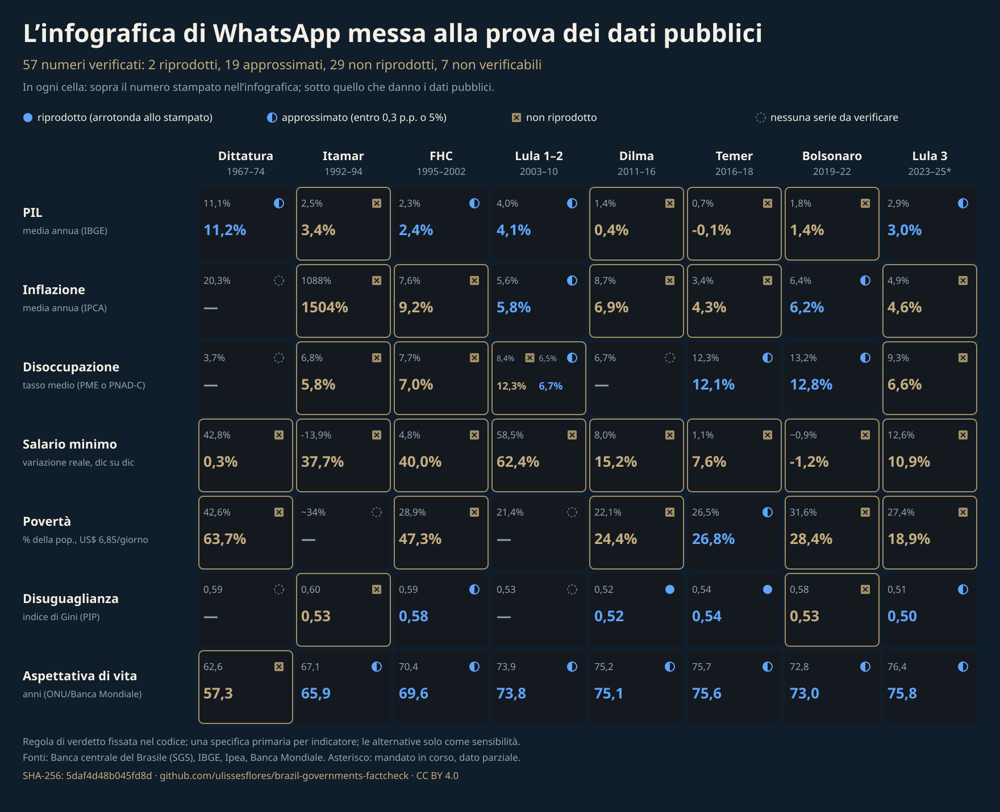

<div align="center">

# Radiografia del Brasile per Governo

**57 numeri di un'infografica virale su otto governi brasiliani, verificati uno per uno contro dati pubblici sotto una regola fissata nel codice; poi la radiografia di ciò che ha lasciato fuori: 103 serie con catena di hash dal 1964, un indice preregistrato delle condizioni di vita e la letteratura sottoposta a revisione paritaria su ogni episodio. Nessun voto di merito.**

[](https://doi.org/10.5281/zenodo.23604103)


[English](README.md) · [Português](README.pt-BR.md) · [Español](README.es.md) · [Italiano](README.it.md) · [עברית](README.he.md)

</div>

> [!IMPORTANT]
> **Risultato.** L'infografica stampa 57 numeri. Con un'unica regola di verdetto fissata nel codice, 2 si riproducono esattamente a partire da dati pubblici, 19 si approssimano, 29 non si riproducono e 7 non hanno una serie ufficiale con cui verificarli. Lascia inoltre fuori il 34,3% dei mesi tra il 1964 e il 2026 (257,6 su 750,1): cinque governi.
> Questo repository non stila classifiche di governi e non dice chi sia favorito dalle omissioni. L'intenzione non si può misurare a partire dai dati.

> [!NOTE]
> L'ebraico è una traduzione automatica, senza revisione umana della resa da destra a sinistra.

## Che cosa apporta

1. **Una regola di verdetto fissata nel codice** (`code/govfc/verdict.py`), applicata a ogni numero dell'infografica, con la specifica primaria dichiarata per ciascun indicatore e ogni alternativa provata riportata come sensibilità.
2. **Dati con una catena di hash (hash chain) fin dal momento del download.** Ogni file è registrato in un `manifest.jsonl` di sola aggiunta (append-only), in cui ogni riga reca l'hash della precedente; l'intero repository viene poi sigillato con un unico `chain_hash` SHA-256.
3. **Un catalogo delle rotture di metodo e di regola** (229 voci), con il motivo indicato da ciascuna fonte, l'effetto misurato dove due metodi si sovrappongono e quali celle dell'infografica attraversano ciascuna rottura; più uno strato curato di 26.490 osservazioni in 279 indicatori, con l'edizione della fonte (vintage) su ogni riga.

## In sintesi

| Voce | Valore |
|---|---|
| Numeri stampati nell'infografica | 57 |
| Si riproducono / si approssimano / non si riproducono / non verificati | 2 / 19 / 29 / 7 |
| Mesi del 1964-2026 che l'infografica omette | 257,6 su 750,1 (34,3%) |
| Osservazioni curate / indicatori / rotture di metodo | 26.490 / 279 / 229 |
| Elementi dell'indice / indicatori del terminale / studi Q1 nello strato della letteratura | 39 / 103 / 43 |
| Emendamenti datati alla preregistrazione | 13 |
| Dipendenze a tempo di esecuzione | nessuna (libreria standard di Python, 3.11+) |

## Avvio rapido

```bash
git clone <repository-url> && cd <repository>
python3 run_all.py
```

L'output atteso termina con:

```text
run_all: OK [Track 1 (sealed series, no network)]
```

Il Percorso 1 non richiede rete: ricostruisce lo strato curato e i risultati dalle serie sigillate, esegue i test e verifica il sigillo e ogni catena di acquisizione. Il Percorso 2 (`python3 run_all.py --full`) comincia scaricando di nuovo i file grandi di terze parti conservati solo come hash più URL, e riesegue gli script di derivazione. Vedi `REPRODUCIBILITY.md`.

## Risultati

L'infografica rifatta (ogni numero è letto da `output/results.json` e fissato da un test):



Ogni cella mostra sopra il numero stampato e sotto il numero riprodotto, con un segno di verdetto che non dipende mai dal solo colore.

## Oltre l'infografica: gli strati aggiunti

Tutto ciò che segue è stato preregistrato e sigillato nella catena di hash prima di essere calcolato (13 emendamenti datati, mai riscritti, in `data/raw/preregistro/`); le regole sono in `docs/it/METHODOLOGY.md`, sezioni da 11 a 16.

1. **Un indice composito delle condizioni di vita** (39 elementi in 13 aree, `output/indice.json`): ogni elemento entra solo con una direzione di lettura stabilita in un articolo di quartile 1, valutato rispetto a soglie congelate 1995-2024, con pesi uguali dichiarati, scenari pubblicati e 10.000 estrazioni di pesi. Descrive le condizioni durante ogni mandato; non classifica il merito.
2. **Un terminale di 103 indicatori in 19 domini** (`output/terminal.json`, pagina `output/raio-x.html`), una base omogenea per cella, due basi disegnate come due linee e mai raccordate, e una lettura per mandato in tre strati separati: l'indice, Brasile meno America Latina sulla stessa fonte e la griglia "inizio -> fine".
3. **Uno strato della letteratura** (27 episodi, 5 tornate pubblicate, 43 studi, `output/literatura.json`): ciò che studi sottoposti a revisione paritaria di quartile 1 con un disegno di identificazione nominato hanno misurato su ogni episodio, trovati da un protocollo di ricerca sigillato prima di cercare, ogni lavoro restituito elencato con il motivo dell'esclusione, senza voto e senza verdetto.
4. **Debito estero e costo del debito pubblico** (`data/raw/externo-fase3/`): i due concetti di debito estero lordo della Banca Centrale mostrati separati, il suo rapporto di debito netto interrotto mostrato come pubblicato e mai prolungato, e gli interessi nominali e il risultato nominale del settore pubblico; nessun valore netto del 2026 viene calcolato perché l'indicatore ufficiale non esiste più.

## Che cosa si afferma e che cosa no

| Affermato | Non affermato | Congelato (non può essere rieseguito) |
|---|---|---|
| Ogni numero stampato è stato confrontato con dati pubblici secondo una regola fissata nel codice | Che un governo sia migliore o peggiore | L'immagine originale e la cattura del post su X |
| Fonti, edizioni e rotture di metodo sono registrate e dotate di hash | Che l'infografica sia stata fatta per favorire qualcuno | Pagine di terze parti cambiate dopo la raccolta (registrate tramite hash) |
| Le alternative provate sono elencate accanto alla specifica primaria | Che i verdetti siano un test preregistrato: le specifiche sono state fissate dopo un passaggio esplorativo | URL attive che ora servono una versione più recente |

## Integrità

```bash
python3 make_provenance.py --verify
```

ricalcola il `chain_hash` e ogni catena di acquisizione. La catena di hash è definita in `docs/it/METHODOLOGY.md`; l'idea di collegare i record tramite hash, in modo che la storia non possa essere riscritta senza essere rilevata, è di Haber e Stornetta (1991).

## Struttura

```text
code/govfc/        verdict rule, hash chain, results, curated layer, figures
data/raw/          downloaded files, derivation scripts, manifest.jsonl per folder
data/curated/      observations, indicators, method breaks, terms of office
data/infographic/  the image (hash) and its transcription
output/            results.json, series.json, provenance.json, figures
docs/<lang>/       methodology in five languages
tests/             published numbers are test assertions
```

## Autore

Carlos Ulisses Flores. ORCID [0000-0002-6034-7765](https://orcid.org/0000-0002-6034-7765) · [ulissesflores.com](https://ulissesflores.com) · [Lattes](http://lattes.cnpq.br/6905246706890561)

## Citazione

Citare il concept DOI 10.5281/zenodo.23604103 (risolve sempre alla versione più recente); un'esecuzione specifica si cita con il suo DOI di versione, mostrato nel record Zenodo di ogni release. Metadati: `CITATION.cff`, `codemeta.json`.

```bibtex
@misc{flores2026raiox,
  author  = {Flores, Carlos Ulisses},
  title   = {Brazil X-Ray by Government: hash-chained public data to check a viral infographic and compare what it omits},
  year    = {2026},
  version = {1.0.1},
  url     = {https://github.com/ulissesflores/brazil-governments-factcheck},
  doi     = {10.5281/zenodo.23604103}
}
```

## Licenza

Codice: Apache-2.0. Documentazione, dati derivati e figure: CC BY 4.0 (`LICENSES/`, `NOTICE`). I documenti di terze parti non vengono ridistribuiti; ciascuno è registrato tramite hash e URL.

## Riferimenti di ancoraggio

Haber e Stornetta (1991) DOI 10.1007/bf00196791 · Peng (2011) DOI 10.1126/science.1213847 · Wilkinson et al. (2016) DOI 10.1038/sdata.2016.18 · Cysne e Coimbra-Lisboa (2004) DOI 10.1590/0101-35172004-1602. Elenco completo in `docs/it/METHODOLOGY.md`.
