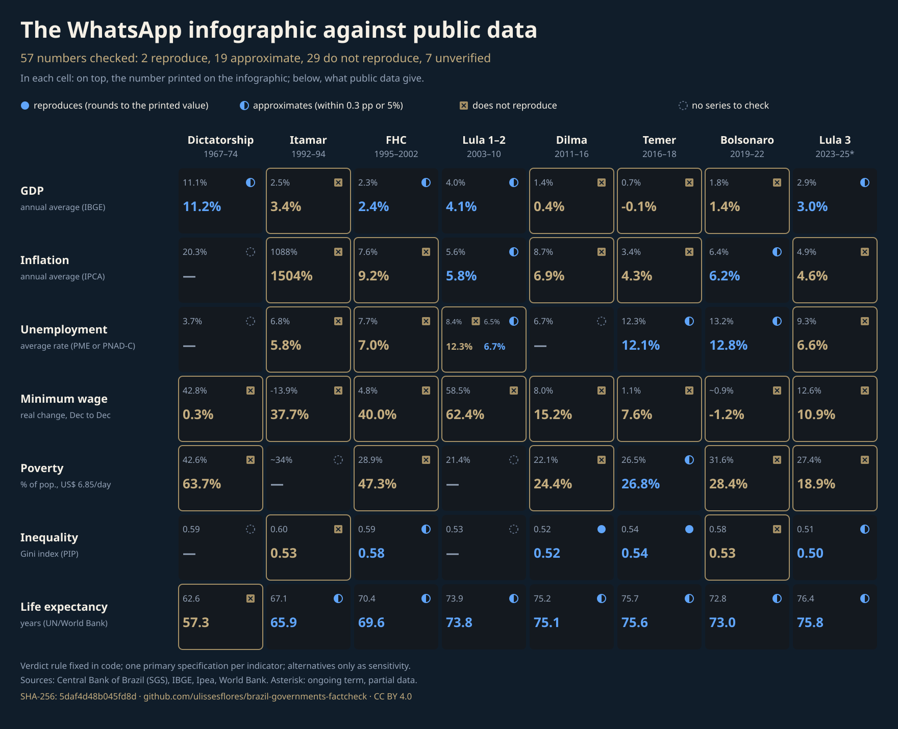

<div align="center">

# Brazil X-Ray by Government

**57 numbers from a viral infographic about eight Brazilian governments, checked one by one against public data under a rule fixed in code; then the X-ray of what it left out: 103 hash-chained series since 1964, a pre-registered index of living conditions and the peer-reviewed literature on each episode. No score of merit.**

[](https://doi.org/10.5281/zenodo.23604103)


[English](README.md) · [Português](README.pt-BR.md) · [Español](README.es.md) · [Italiano](README.it.md) · [עברית](README.he.md)

</div>

> [!IMPORTANT]
> **Finding.** The infographic prints 57 numbers. Under one verdict rule fixed in code, 2 reproduce exactly from public data, 19 approximate, 29 do not reproduce and 7 have no official series to check. It also leaves out 34.3% of the months between 1964 and 2026 (257.6 of 750.1): five governments.
> This repository does not rank governments and does not say whom the omissions favour. Intent cannot be measured from data.

> [!NOTE]
> Hebrew is a machine translation with no human review of right-to-left rendering.

## What this contributes

1. **A verdict rule fixed in code** (`code/govfc/verdict.py`) applied to every number of the infographic, with the primary specification declared per indicator and every alternative tried reported as sensitivity.
2. **Data with a hash chain from the moment of download.** Every file is recorded in an append-only `manifest.jsonl` where each line carries the hash of the previous one; the whole repository is then sealed with one SHA-256 `chain_hash`.
3. **A catalogue of method and rule breaks** (229 entries) with the reason each source gives, the effect measured where two methods overlap, and which infographic cells cross each break; plus a curated layer of 26,490 observations in 279 indicators, with the source edition (vintage) on every row.

## At a glance

| Item | Value |
|---|---|
| Numbers printed on the infographic | 57 |
| Reproduce / approximate / do not reproduce / unverified | 2 / 19 / 29 / 7 |
| Months of 1964-2026 the infographic omits | 257.6 of 750.1 (34.3%) |
| Curated observations / indicators / method breaks | 26,490 / 279 / 229 |
| Index items / terminal indicators / Q1 studies in the literature layer | 39 / 103 / 43 |
| Dated amendments to the pre-registration | 13 |
| Runtime dependencies | none (Python standard library, 3.11+) |

## Quick start

```bash
git clone <repository-url> && cd <repository>
python3 run_all.py
```

Expected output ends with:

```text
run_all: OK [Track 1 (sealed series, no network)]
```

Track 1 needs no network: it rebuilds the curated layer and the results from the sealed series, runs the tests, and verifies the seal and every acquisition chain. Track 2 (`python3 run_all.py --full`) first downloads again the large third-party files that are kept as hash plus URL only, and re-runs the derivation scripts. See `REPRODUCIBILITY.md`.

## Results

The redone infographic (every number is read from `output/results.json` and pinned by a test):



Each cell shows the printed number above and the reproduced number below, with a verdict mark that never relies on colour alone.

## Beyond the infographic: the layers added

Everything below was pre-registered and sealed in the hash chain before being computed (13 dated amendments, never rewritten, in `data/raw/preregistro/`); the rules are in `docs/en/METHODOLOGY.md`, sections 11 to 16.

1. **A composite index of living conditions** (39 items in 13 areas, `output/indice.json`): every item enters only with a reading direction established in a quartile-1 article, scored against frozen goalposts 1995-2024, with equal declared weights, published scenarios and 10,000 weight draws. It describes conditions during each term; it does not rank merit.
2. **A terminal of 103 indicators in 19 domains** (`output/terminal.json`, page `output/raio-x.html`), one homogeneous base per cell, two bases drawn as two lines and never spliced, and a reading by term in three separate layers: the index, Brazil minus Latin America on the same source, and the "start -> end" grid.
3. **A literature layer** (27 episodes, 5 published rounds, 43 studies, `output/literatura.json`): what peer-reviewed quartile-1 studies with a named identification design measured about each episode, found by a search protocol sealed before searching, every returned work listed with its reason for exclusion, no score and no verdict.
4. **External debt and the cost of public debt** (`data/raw/externo-fase3/`): the Central Bank's two concepts of gross external debt shown apart, its discontinued net-debt ratio shown as published and never extended, and the nominal interest and nominal result of the public sector; no 2026 net figure is computed because the official indicator no longer exists.

## What is and is not claimed

| Claimed | Not claimed | Frozen (cannot be re-run) |
|---|---|---|
| Each printed number was compared with public data under a rule fixed in code | That any government is better or worse | The original image and the capture of the X post |
| Sources, editions and method breaks are recorded and hashed | That the infographic was made to favour anyone | Third-party pages that changed after collection (recorded by hash) |
| Alternatives tried are listed next to the primary specification | That the verdicts are a pre-registered test: the specifications were fixed after an exploratory pass | Live URLs that now serve a newer version |

## Integrity

```bash
python3 make_provenance.py --verify
```

recomputes the `chain_hash` and every acquisition chain. The hash chain is defined in `docs/en/METHODOLOGY.md`; the idea of linking records by hashes so history cannot be rewritten without detection is Haber and Stornetta (1991).

## Layout

```text
code/govfc/        verdict rule, hash chain, results, curated layer, figures
data/raw/          downloaded files, derivation scripts, manifest.jsonl per folder
data/curated/      observations, indicators, method breaks, terms of office
data/infographic/  the image (hash) and its transcription
output/            results.json, series.json, provenance.json, figures
docs/<lang>/       methodology in five languages
tests/             published numbers are test assertions
```

## Author

Carlos Ulisses Flores. ORCID [0000-0002-6034-7765](https://orcid.org/0000-0002-6034-7765) · [ulissesflores.com](https://ulissesflores.com) · [Lattes](http://lattes.cnpq.br/6905246706890561)

## Citation

Cite the concept DOI 10.5281/zenodo.23604103 (it always resolves to the latest version); a specific run is cited by its version DOI, shown on the Zenodo record of each release. Metadata: `CITATION.cff`, `codemeta.json`.

```bibtex
@misc{flores2026raiox,
  author  = {Flores, Carlos Ulisses},
  title   = {Brazil X-Ray by Government: hash-chained public data to check a viral infographic and compare what it omits},
  year    = {2026},
  version = {1.0.1},
  url     = {https://github.com/ulissesflores/brazil-governments-factcheck},
  doi     = {10.5281/zenodo.23604103}
}
```

## License

Code: Apache-2.0. Documentation, derived data and figures: CC BY 4.0 (`LICENSES/`, `NOTICE`). Third-party documents are not redistributed; each is recorded by hash and URL.

## Anchor references

Haber and Stornetta (1991) DOI 10.1007/bf00196791 · Peng (2011) DOI 10.1126/science.1213847 · Wilkinson et al. (2016) DOI 10.1038/sdata.2016.18 · Cysne and Coimbra-Lisboa (2004) DOI 10.1590/0101-35172004-1602. Full list in `docs/en/METHODOLOGY.md`.
